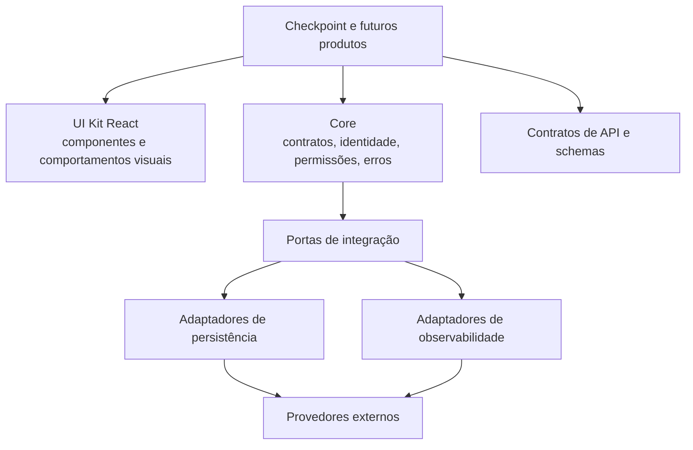
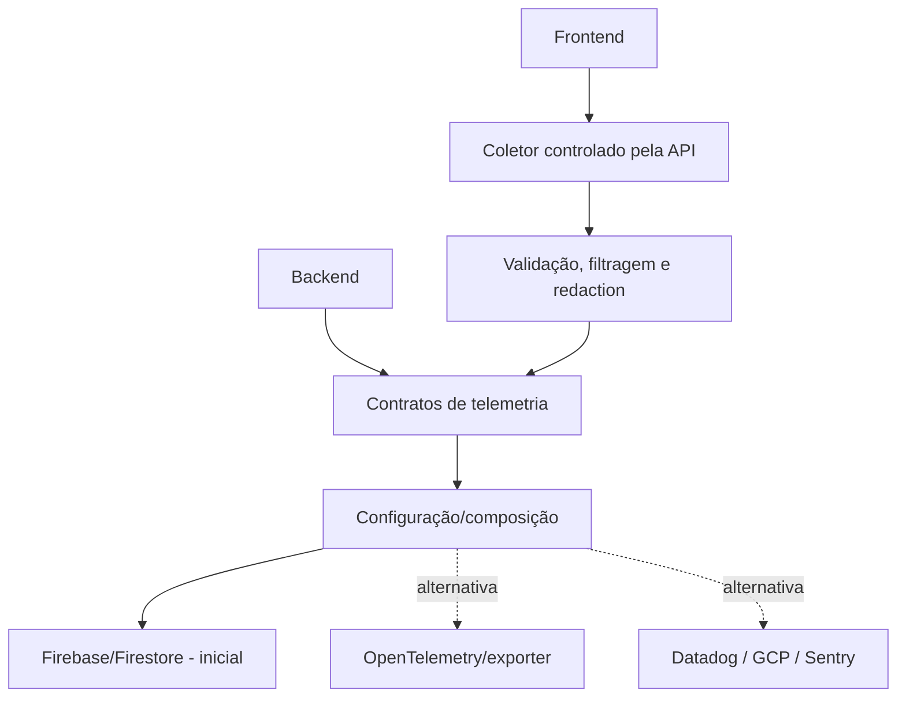

# Checkpoint — Avaliação arquitetural e proposta de evolução

**Tipo:** análise de produto e arquitetura conceitual (modo DIALOGUE; não é um `PRODUCT_SPEC`)  
**Data:** 14 de outubro de 2026  
**Versão:** 1.0  
**Status:** recomendações para discussão, sem autorização de implementação  
**Repositório avaliado:** https://github.com/lvgusson/checkpoint  
**Referência:** branch pública `main`, inspecionada em 14/10/2026

> **Objetivo:** evoluir o Checkpoint para React e utilizá-lo como primeiro consumidor de uma base reutilizável para projetos futuros, com autenticação, autorização, comunicação HTTP, validação, gerenciamento de estado remoto, observabilidade e componentes de interface consistentes. Fazer isso com o menor grau de complexidade compatível com segurança, qualidade e evolução.

> **Limite da avaliação:** a análise foi feita a partir dos arquivos disponíveis no GitHub. Não foi executada uma auditoria completa em ambiente de produção, teste de carga, teste de intrusão ou validação interativa do app. Achados de código não devem ser confundidos com falhas comprovadamente exploráveis.

---

## 1. Resumo executivo

O Checkpoint **não precisa ser reconstruído integralmente**. Sua base atual já apresenta decisões tecnicamente úteis: API versionada, documentação OpenAPI, camada de serviços, repositórios intercambiáveis, testes, autenticação Supabase, validação local de JWT, refresh concorrente no frontend e cache stale-while-revalidate.

A maior mudança proposta está na **camada de frontend** e na formalização das **fronteiras compartilháveis**. A migração para React deve preservar contratos, regras de pontuação, isolamento dos dados por usuário e comportamento funcional existente.

A recomendação central é **fazer do Checkpoint o primeiro produto que usa um core reutilizável, sem transformar o próprio aplicativo em um framework**. A base compartilhada precisa ser modular, mas a extração para pacotes independentes e sua publicação podem esperar um segundo projeto consumidor.

**Diretrizes principais:**

1. Preservar o domínio e a API existentes enquanto se moderniza o frontend.
2. Usar React, TypeScript, Ky, TanStack Query, Zod e componentes acessíveis, conforme as preferências indicadas.
3. Separar _autenticação_, _permissões de negócio_ e _acesso autorizado a recursos_.
4. Implementar observabilidade por capacidades e contratos, sem acoplamento a Firebase, Datadog, Sentry ou GCP.
5. Centralizar comportamento reutilizável das listas, mas não misturar regra de negócios com componentes visuais.
6. Exigir validações do servidor, códigos padronizados de erro, testes de isolamento e boas práticas de sessão.
7. Evitar Redis, microsserviços, filas duráveis, abstrações excessivas e otimização prematura sem requisitos que os justifiquem.

**Princípio:** robustez não é quantidade de bibliotecas. É comportamento previsível sob condições normais, adversas e de falha, com recuperação, segurança e critérios verificáveis.

---

## 2. O que foi encontrado no repositório

### 2.1. Visão geral

| Área              | Situação observada                                                             | Avaliação                                                                                        |
| ----------------- | ------------------------------------------------------------------------------ | ------------------------------------------------------------------------------------------------ |
| Frontend          | Angular 22 e componentes próprios                                              | Migrar para React por decisão do proprietário do produto                                         |
| Backend           | Node.js 24, API HTTP com `node:http`                                           | Preservar serviços e domínio; estudar troca da camada HTTP somente se trouxer benefício concreto |
| Dados             | PostgreSQL/Supabase e repositórios JSON para uso local                         | Boa separação inicial; preservar interfaces e contratos                                          |
| Autenticação      | Supabase Auth, JWT via `jose`, restauração de sessão e refresh                 | Não reconstruir do zero; refinar segurança e política de sessão                                  |
| API               | `/api/v1`, documento OpenAPI                                                   | Preservar compatibilidade ou versionar alterações intencionais                                   |
| Cache de frontend | `DataCache` próprio, stale-while-revalidate, cache em memória e `localStorage` | Substituir responsabilidades sobrepostas pelo TanStack Query, sem perder semântica               |
| Autorização       | Identidade e isolamento de usuário; RBAC de negócio não consolidado            | Adicionar mecanismo de permissão declarativa e validar recursos                                  |
| Observabilidade   | Logging principalmente via `console`                                           | Formalizar logs, erros, métricas e rastreamento com portas/adaptadores                           |
| Qualidade         | Testes Node, TypeScript, ESLint, Prettier, scripts de validação                | Preservar e ampliar para frontend, contratos e segurança                                         |
| Hospedagem        | Vercel e Supabase                                                              | Opção inicial plausível; conferir limites e características operacionais conforme o uso real     |

### 2.2. Pontos fortes existentes

**JWT verificado localmente.** `api/src/auth.ts` utiliza `jose` e JWKS com cache, o que evita uma consulta de rede ao provedor de identidade para cada chamada quando o JWT usa assinatura assimétrica suportada. Há fallback remoto para tokens HS256 legados. Portanto, a proposta de autenticação rápida não começa do zero.

**Renovação concorrente de sessão.** `web/src/auth/auth.service.ts` compartilha uma promessa de refresh quando várias chamadas encontram o token expirado. `web/src/auth/auth.interceptor.ts` faz uma tentativa adicional da operação após refresh. Essa propriedade deve ser transportada para a integração com Ky e testada.

**Cache com política explícita.** `web/src/data-cache.ts` tem SWR, deduplicação de chamadas em voo, invalidação, escopo por usuário e persistência opcional. É uma implementação própria com responsabilidades que, em grande parte, podem migrar para TanStack Query. O comportamento de dados antigos durante mutações precisa ser preservado com cuidado.

**Injeção de persistência.** O serviço de jogos recebe repositórios; `api/src/setup.ts` seleciona PostgreSQL ou arquivos JSON. A separação é valiosa e não deve ser descartada para tornar o projeto visualmente mais “moderno”.

**API e rotinas existentes.** Há rotas de jogos, listas, reordenação, wishlist, integração Steam, configurações e outros comportamentos já desenvolvidos. O escopo da mudança deve proteger esse investimento funcional.

### 2.3. Riscos e pontos a revisar

| Ponto                               | Evidência no código                                                      | Risco/ação recomendada                                                                                    |
| ----------------------------------- | ------------------------------------------------------------------------ | --------------------------------------------------------------------------------------------------------- |
| Mensagens de exceção na resposta    | `api/src/server.ts` envia `e.message` mesmo para erros não classificados | Evitar exposição de detalhes internos; padronizar resposta pública e manter detalhes técnicos nos logs    |
| Acesso PostgreSQL fora de RLS       | `api/src/app-user.ts` comenta que o acesso direto não aplica RLS         | Auditoria sistemática de filtros de proprietário, testes entre usuários e permissões mínimas no banco     |
| Retorno antecipado em reordenação   | `/queue/reorder` responde antes da conclusão do trabalho em background   | Diferenciar aceite da operação de persistência concluída; determinar reconciliação e tratamento de falhas |
| Autenticação opcional em dev        | `authenticatorFromEnv()` retorna `null` sem Supabase fora de produção    | Garantir impossibilidade de ativação acidental de modo sem autenticação em ambiente público               |
| Persistência de sessão no navegador | `supabase-js` com `persistSession: true`                                 | Documentar riscos de XSS e avaliar BFF com cookies seguros quando o produto exigir maior proteção         |
| Cache customizado                   | `DataCache` em memória/`localStorage`                                    | Evitar ter dois caches concorrentes depois de introduzir TanStack Query                                   |
| Acoplamento a implementação de UI   | Componentes e serviços Angular atuais                                    | Definir limites de domínio, contratos e UI antes de migrar cada tela                                      |

**Atenção:** esses pontos são itens de revisão, não afirmações de exploração comprovada.

### 2.4. Arquivos de referência

- [package.json](https://github.com/lvgusson/checkpoint/blob/main/package.json)
- [README.md](https://github.com/lvgusson/checkpoint/blob/main/README.md)
- [api/src/auth.ts](https://github.com/lvgusson/checkpoint/blob/main/api/src/auth.ts)
- [api/src/server.ts](https://github.com/lvgusson/checkpoint/blob/main/api/src/server.ts)
- [api/src/context.ts](https://github.com/lvgusson/checkpoint/blob/main/api/src/context.ts)
- [api/src/app-user.ts](https://github.com/lvgusson/checkpoint/blob/main/api/src/app-user.ts)
- [api/src/setup.ts](https://github.com/lvgusson/checkpoint/blob/main/api/src/setup.ts)
- [web/src/auth/auth.service.ts](https://github.com/lvgusson/checkpoint/blob/main/web/src/auth/auth.service.ts)
- [web/src/auth/auth.interceptor.ts](https://github.com/lvgusson/checkpoint/blob/main/web/src/auth/auth.interceptor.ts)
- [web/src/data-cache.ts](https://github.com/lvgusson/checkpoint/blob/main/web/src/data-cache.ts)
- [web/src/api.ts](https://github.com/lvgusson/checkpoint/blob/main/web/src/api.ts)
- [docs/openapi.json](https://github.com/lvgusson/checkpoint/blob/main/docs/openapi.json)
- [vercel.json](https://github.com/lvgusson/checkpoint/blob/main/vercel.json)

---

## 3. Stack proposta e avaliação

| Camada                  | Proposta                                     | Razão                                                                            | Situação                                        |
| ----------------------- | -------------------------------------------- | -------------------------------------------------------------------------------- | ----------------------------------------------- |
| Frontend                | React + TypeScript + Vite                    | Ecossistema amplo, app cliente e build simples                                   | **Preferência React confirmada; Vite proposto** |
| Rotas frontend          | TanStack Router                              | Rotas tipadas, parâmetros, integração com loaders e guards de navegação          | **Proposto**                                    |
| HTTP                    | Ky                                           | Instância HTTP configurada e hooks para autenticação/erros                       | **Preferência declarada**                       |
| Estado remoto           | TanStack Query                               | Cache, deduplicação, prefetch, invalidação, mutações e sincronização             | **Preferência declarada**                       |
| Esquemas                | Zod                                          | Validação em runtime de entradas, saídas e configuração                          | **Preferência declarada**                       |
| Interface               | Tailwind CSS + shadcn/ui                     | Componentes acessíveis, customização e baixa dependência visual de um fornecedor | **Proposto**                                    |
| Formulários             | React Hook Form + Zod                        | Estado de formulário, feedback e validação                                       | **Proposto**                                    |
| Drag and drop           | dnd-kit                                      | Ordenação por ponteiro, toque e teclado                                          | **Proposto**                                    |
| Tabelas                 | TanStack Table quando necessário             | Ordenação/filtros/tabulação headless                                             | **Opcional**                                    |
| Virtualização           | TanStack Virtual quando medição justificar   | Redução do número de elementos montados                                          | **Opcional**                                    |
| Autenticação            | Supabase Auth                                | Já integrado, suporte a sessões e OAuth                                          | **Manutenção proposta**                         |
| Autorização             | RBAC declarativo próprio no início           | Simplicidade e avaliação em memória                                              | **Proposto**                                    |
| Permissões condicionais | CASL, se surgirem regras complexas           | Regras `can`/`cannot` e condições por objeto                                     | **Alternativa futura**                          |
| API backend             | Node.js, mantendo serviços existentes        | Evitar migração desnecessária do domínio                                         | **Proposto**                                    |
| Banco de dados          | PostgreSQL/Supabase                          | Existente e adequado ao perfil atual                                             | **Manutenção proposta**                         |
| Observabilidade         | Contratos próprios; considerar OpenTelemetry | Neutralidade de fornecedor e interoperabilidade                                  | **Proposto**                                    |
| Destino inicial de logs | Firebase/Firestore via adaptador do backend  | Alinha-se à preferência atual, com ressalvas operacionais                        | **Preferência declarada, não validada**         |
| Testes de frontend      | Vitest + Testing Library + Playwright + MSW  | Cobertura unitária, de UI, jornadas e integrações simuladas                      | **Proposto**                                    |

**Não adotar agora, sem justificativa adicional:** Redux para estado remoto, microsserviços, Redis, Kafka, gateway dedicado, service mesh, múltiplos bancos, workers distribuídos ou arquitetura de plugins interna excessivamente elaborada.

**Não é uma imposição de stack para o Tech Advisor.** Escolhas como TanStack Router versus React Router e como organizar o build da API devem ser revisitadas no momento da engenharia executável.

---

## 4. Arquitetura conceitual e reutilização

### 4.1. Separação por responsabilidades



**Core:** capacidades não visuais, independentes de produto e de fornecedor.

**UI Kit:** componentes React e convenções de experiência, sem regras sobre jogos, fila ou wishlist.

**Contracts:** tipos, esquemas e acordos de comunicação que podem ser compartilhados entre backend e frontend.

**Adapters:** integração concreta com serviços externos, bancos e provedores.

**Apps:** composition root, telas, configurações e regras específicas de cada produto.

### 4.2. Estrutura conceitual sugerida

```text
apps/
  checkpoint-web/
  checkpoint-api/

packages/
  contracts/
  core/
  ui-react/
  adapters/
  testing/
```

O formato acima descreve **fronteiras lógicas**. Não exige que todos os diretórios sejam pacotes publicados nem que o monorepo adote imediatamente uma ferramenta de orquestração específica. É aceitável iniciar com módulos locais e extrair os pacotes na hora certa.

### 4.3. Regras de dependência

- `core` não deve importar React, Firebase, Supabase ou entidades do Checkpoint.
- `ui-react` pode depender de contratos estáveis e primitivas de UI, mas não de repositórios de jogos.
- Adaptadores dependem dos contratos; contratos não dependem dos adaptadores.
- Apps configuram quais implementações concretas usar.
- O backend continua sendo autoridade sobre regras de negócio, permissões e persistência.
- Reutilização não é duplicar uma classe genérica que exige muitas condições específicas por produto.
- Padrões como classe abstrata, interface, composição, injeção e Strategy devem ser escolhidos pelo comportamento necessário, não por preferência estética.

### 4.4. Critério para extrair uma biblioteca

Extrair quando houver **pelo menos um consumidor real e um segundo caso de uso demonstrável**, interface minimamente estável e benefício de manutenção. É aceitável manter contratos e implementações inicialmente no mesmo repositório.

---

## 5. Observabilidade agnóstica ao fornecedor

### 5.1. Não criar um único serviço monolítico

A proposta de usar Strategy está correta quanto ao desacoplamento, mas uma única classe `Observability` com dezenas de métodos mistura responsabilidades. Recomenda-se dividir em quatro capacidades:

| Contrato          | Papel                             | Operações conceituais                  |
| ----------------- | --------------------------------- | -------------------------------------- |
| `Logger`          | Eventos estruturados              | `debug`, `info`, `warn`, `error`       |
| `ErrorReporter`   | Captura de falhas                 | `captureException`, `captureMessage`   |
| `MetricsRecorder` | Indicadores numéricos             | `increment`, `recordDuration`, `gauge` |
| `Tracer`          | Propagação e duração de operações | `startSpan`, `endSpan`                 |

Cada contrato pode ter implementações `Noop`, local/desenvolvimento e provedores concretos. Interface TypeScript costuma bastar; classe abstrata se justifica quando houver comportamento compartilhado real.

**Portabilidade não significa paridade total de recursos.** O Firestore armazena eventos, mas não se torna automaticamente equivalente a Datadog, Sentry ou Cloud Monitoring. A troca de adaptador deve garantir operações comuns; funcionalidades exclusivas permanecem opcionais.

### 5.2. Fluxo recomendado



**Não enviar irrestritamente logs de navegador direto ao Firestore.** Riscos incluem custos e volume imprevisível de escrita, abuso, dados pessoais inadvertidos, regras de segurança complexas, spam, ruído e credenciais/tokens vazados nos eventos.

Para o MVP, o frontend pode registrar eventos relevantes em um coletor da API com autenticação quando apropriada, limites de tamanho e frequência, validação, categorização e descarte de campos proibidos. O backend emite telemetria diretamente pelo contrato.

### 5.3. Campos estruturados recomendados

- `timestamp`, `environment`, `appVersion`, `service`, `severity` e `eventName`;
- `requestId`, `traceId` e, quando aplicável, `spanId`;
- `operation`, `durationMs`, `status`, `errorCode` e `retryCount`;
- identificador pseudonimizado ou minimizado de usuário quando imprescindível;
- tags de categoria de evento, sem payload bruto indiscriminado.

**Nunca registrar:** access token, refresh token, senha, segredo, chave privada, header de autorização, URL de reset com credenciais, dados pessoais desnecessários ou o corpo integral de chamadas sensíveis.

### 5.4. Garantias operacionais

- Captura de erro não pode bloquear o fluxo principal da interface.
- Falha da telemetria não deve derrubar a API.
- Buffer com limite, descarte controlado e política clara para quando o provedor estiver indisponível.
- Retentativas com backoff e limite; evitar tempestade de eventos.
- Amostragem para eventos volumosos; exceções críticas seguem regra própria.
- Retenção, expurgo e controle de acesso definidos antes de registrar dados reais.
- Métricas de volume, falhas de envio e latência da própria telemetria.
- Auditoria de ações administrativas **separada** de logs comuns; eventos de auditoria relevantes não devem ser perdidos por amostragem arbitrária.

### 5.5. OpenTelemetry

OpenTelemetry é uma referência útil para traces, métricas e logs e ajuda a reduzir dependência de fornecedor. A maturidade de certos SDKs, especialmente no browser e para logs, deve ser validada antes da decisão definitiva. Os contratos do projeto não devem presumir que todos os exporters conseguem realizar todas as operações com as mesmas características.

**Status:** abstração é requisito declarado; contratos específicos e escolha do formato de exportação são recomendações. Firebase é destino inicial desejado, ainda sujeito a validação de limites e operação.

---

## 6. Autenticação, sessão e autorização

### 6.1. Três problemas diferentes

1. **Autenticação:** quem está fazendo a requisição?
2. **Autorização por ação:** a role permite criar, ler, alterar, excluir ou administrar?
3. **Autorização por recurso:** mesmo com aquela permissão, o usuário pode agir _neste registro_, pertencente _a este usuário/tenant_?

Uma tela escondida ou um guard do React **não** constitui proteção de API. A verificação no servidor e o isolamento de dados permanecem obrigatórios.

### 6.2. Fluxo proposto de sessão

```mermaid
sequenceDiagram
    participant U as Cliente
    participant ID as Supabase Auth
    participant API as API
    participant DB as PostgreSQL

    U->>ID: Login / restauração de sessão
    ID-->>U: Sessão e access token
    U->>API: Requisição com access token
    API->>API: Verificar JWT localmente com JWKS em cache
    API->>API: Autorizar ação com política
    API->>DB: Consulta com isolamento do recurso
    DB-->>API: Dados permitidos
    API-->>U: Resposta
    Note over U,ID: Refresh quando necessário; chamadas concorrentes compartilham a renovação
```

O caminho comum não deve exigir cinco consultas para descobrir permissão. Idealmente, o token validado fornece identidade e, conforme a estratégia, claims de autorização estáveis o suficiente para a operação. Permissões são avaliadas em memória. A consulta ao recurso é a que a operação já exigiria.

**Exceção importante:** autorização que muda em tempo real, revogação urgente, bloqueio de usuário, participação em organização ou condições por recurso podem exigir consulta ou cache de decisão com invalidação. Reduzir latência nunca deve permitir acesso indevido.

### 6.3. Access token e refresh token

**Proposta inicial:** preservar Supabase Auth e seu mecanismo de sessão/rotação de refresh token. A integração do Ky deve:

- anexar token somente à API autorizada, nunca a origens arbitrárias;
- evitar enviar token para rotas públicas desnecessariamente;
- compartilhar o refresh entre requisições concorrentes (_single flight_);
- repetir no máximo uma vez depois de renovar sessão em caso de `401` elegível;
- não tentar refresh em `403`, erro de validação ou `5xx`;
- encerrar a sessão e limpar dados do usuário quando renovação for impossível;
- evitar repetição automática insegura de mutações sem garantia de idempotência;
- reconhecer a diferença entre token expirado e indisponibilidade transitória do provedor.

**Decisão pendente:** continuar com tokens sob controle do SDK no navegador ou migrar, para novos produtos de maior sensibilidade, a uma arquitetura BFF baseada em sessão/cookies `HttpOnly`, `Secure` e `SameSite`, com proteção adequada contra CSRF. A segunda opção reduz exposição de credenciais ao JavaScript em certas ameaças, mas adiciona responsabilidades de backend e não elimina vulnerabilidades XSS.

### 6.4. RBAC simples e declarativo

Papéis exemplificativos, **não confirmados como regras do Checkpoint**: `OWNER`, `ADMIN`, `EDITOR`, `VIEWER`.

Permissões exemplificativas:

- `games:read`, `games:create`, `games:update`, `games:delete`;
- `lists:read`, `lists:create`, `lists:reorder`, `lists:delete`;
- `settings:update`, `users:manage`.

Política conceitual: uma role concede ou nega ações; o servidor avalia a política no contexto da requisição. A mesma representação pode orientar a UI a não oferecer ações impossíveis. O backend nunca deve confiar no resultado informado pelo frontend.

**Cuidado com a claim `role` do Supabase:** o valor padrão `authenticated` representa um papel técnico no ecossistema do provedor, não necessariamente `ADMIN`, `EDITOR` ou outra role do produto. Permissões de negócio exigem representação própria.

### 6.5. Role no JWT, banco ou cache?

| Abordagem                                        | Latência                                                | Principal limitação                                                        |
| ------------------------------------------------ | ------------------------------------------------------- | -------------------------------------------------------------------------- |
| Role/permissões em claims verificadas localmente | Baixa; nenhuma consulta adicional para política simples | Claims antigas persistem até renovação/expiração ou mecanismo de revogação |
| Role consultada no banco por requisição          | Consulta adicional                                      | Mais atualidade; maior custo de latência e carga                           |
| Role em cache com invalidação                    | Leitura rápida frequente                                | Coerência, propagação de revogação e complexidade operacional              |

**Recomendação inicial:** políticas de papéis declaradas em código, decisão local, identidade validada por JWT e autorização por recurso no acesso aos dados. Se roles forem alteráveis em runtime ou entre organizações, introduzir um mecanismo de atualização/revogação claro. Não há escolha universal que entregue latência mínima e revogação imediata sem concessões.

### 6.6. RBAC próprio versus CASL

**RBAC próprio:** mais simples, rápido de entender, com superfície pequena de manutenção. Preferível enquanto permissões forem basicamente papel + ação + recurso.

**CASL:** útil quando as regras precisarem de `can`/`cannot`, condições por propriedades, exceções por objeto e lógica mais flexível. Evitar adotar antes de demonstrar essa necessidade.

Exemplos de política: leitura pública de catálogo pode coexistir com edição privada de notas; permissão de editar jogos não deve autorizar mexer em avaliações de outro usuário.

### 6.7. Isolamento no banco

O código atual usa conexão PostgreSQL direta que não depende de RLS para todas as consultas da API. Os filtros implementados no repositório tornam-se parte essencial da segurança.

Recomenda-se:

- testar todas as rotas com dois usuários e recursos de proprietários diferentes;
- centralizar escopo de usuário/tenant onde possível;
- aplicar _deny by default_ para ausência de escopo;
- minimizar privilégios da credencial de banco usada pela aplicação;
- reavaliar se determinados acessos devem usar RLS efetivamente ou política na API;
- impedir troca de proprietário por parâmetros enviados pelo cliente;
- registrar de forma apropriada mudanças administrativas de permissão.

---

## 7. Comunicação HTTP, contratos e tratamento centralizado de erros

### 7.1. Responsabilidades por camada

**Ky:** transporte, URL base, timeout, cabeçalhos, correlação, autenticação e normalização inicial das falhas.

**TanStack Query:** estado de carregamento, cache, deduplicação, prefetch, invalidação, _retry_ coordenado, mutações e reconciliação.

**Zod:** validação em runtime nas fronteiras necessárias (dados recebidos de fontes externas, entradas de API e envs). Tipos TypeScript isolados não garantem validação em execução.

**UI:** apresentação contextual do erro — campo inválido, alerta inline, toast, tela de erro, operação desfeita, retry manual, etc.

**API:** padronização de contratos, autorização, validação e mapeamento seguro entre exceção interna e resposta pública.

### 7.2. Erros padronizados

Adotar como referência **HTTP Problem Details (RFC 9457)**, com status, título, detalhe público seguro e propriedades adicionais controladas, por exemplo código de erro, `requestId` e detalhes de validação.

| Caso                            | HTTP esperado | Experiência proposta                                         |
| ------------------------------- | ------------- | ------------------------------------------------------------ |
| Falta/expiração de autenticação | 401           | Refresh único quando apropriado; depois login                |
| Permissão negada                | 403           | Mensagem de acesso negado; sem refresh                       |
| Recurso inexistente             | 404           | Estado de não encontrado                                     |
| Edição concorrente/conflito     | 409           | Exibir conflito e orientar reconciliação                     |
| Validação semântica             | 422           | Mensagem no campo ou formulário                              |
| Limite de requisições           | 429           | Respeitar `Retry-After` e evitar repetição em massa          |
| Falha do servidor               | 5xx           | Mensagem genérica e identificador rastreável                 |
| Sem rede ou timeout             | Variável      | Preservar entrada, mostrar conexão e permitir nova tentativa |

**Não enviar stack trace ou mensagens internas indiscriminadamente ao navegador.** O log técnico pode conter contexto operacional depois de higienização, mas a resposta pública deve ser limitada.

### 7.3. Retentativas e idempotência

Ky e TanStack Query **não** devem executar políticas de retry independentes que multipliquem tentativas. Definir um único comportamento efetivo por tipo de operação.

- Leituras idempotentes: retentativas limitadas para falhas transitórias.
- Falhas definitivas de autenticação/permissão/validação: sem retry automático.
- Escritas: retry somente quando a semântica for segura; considerar chave de idempotência para operações críticas.
- Resposta ambígua após timeout: a UI não deve presumir que nada foi gravado; reconsulta ou reconciliação pode ser necessária.
- Operações longas: diferenciar aceita, em andamento, concluída e falhou.

### 7.4. Contrato OpenAPI

Preservar a abordagem API-first. Decidir como schemas Zod, tipos compartilhados e OpenAPI serão mantidos coerentes. Não gerar três representações independentes de contratos que possam divergir silenciosamente. Testes de contrato devem proteger compatibilidade entre API antiga e frontend React.

---

## 8. Core visual e coleções de dados

### 8.1. Uma capacidade de coleção, não uma lista monolítica

Propõe-se uma capacidade conceitual `DataCollection` desacoplada das entidades do Checkpoint. Ela define interface entre carregamento, estado de filtros, paginação, ordenação, seleção e apresentação.

| Capacidade       | Comportamento reutilizável desejado                                   |
| ---------------- | --------------------------------------------------------------------- |
| Lista / cards    | Troca de modo sem perder filtros ou página indevidamente              |
| Paginação        | Local ou remota; número de página ou cursor                           |
| Prefetch         | Carregar páginas futuras segundo política configurável                |
| Busca            | Debounce, cancelamento de resposta obsoleta e URL sincronizada        |
| Filtros          | Estado serializável, reset, ordenação e persistência conforme produto |
| Drag and drop    | Mouse, toque, teclado e feedback acessível                            |
| Seleção          | Simples, múltipla ou nenhuma                                          |
| Responsividade   | Adaptação de densidade e controles                                    |
| Estados          | Loading, skeleton, vazio, erro, offline, atualização e sucesso        |
| Virtualização    | Ativação apenas quando volume e medição justificarem                  |
| Customização     | Renderização de card/linha e ações específicas do produto             |
| Mutação otimista | Exibição imediata com rollback/reconciliação quando apropriado        |

Outros componentes básicos candidatos: `PageLayout`, `EmptyState`, `ErrorState`, `ConfirmDialog`, `FilterBar`, `SearchField`, `Pagination`, `DataCard`, `DataTable`, `FormField`, `PermissionGate`, notificações e controles acessíveis de feedback. São candidatos, não escopo obrigatório inicial.

### 8.2. Política de prefetch — duas páginas

A interpretação **proposta** para sua solicitação é: ao consultar a página `N`, procurar manter até `N+1` e `N+2` em cache, desde que existam e respeitando uma política de rede.

Regras que devem ser discutidas:

1. Ativar prefetch após a página atual ter sido obtida ou em um momento de ociosidade adequado.
2. Limitar simultaneidade e cancelá-lo/invalidá-lo quando filtros, ordenação ou identidade mudarem.
3. Respeitar conexão lenta, economia de dados e orçamento de requisições.
4. Prefetch é melhor esforço; nunca deve bloquear a visualização da página atual.
5. Configurar quantidade de páginas e duração de cache por coleção.
6. Evitar buscar páginas inexistentes.
7. Distinguir página numérica de paginação por cursor; não pressupor que toda API suporta ambos.

**Nota técnica:** `maxPages` do TanStack Query limita páginas mantidas em determinadas queries infinitas; não significa automaticamente “prefetch de duas páginas à frente”. A política deve ser modelada separadamente.

### 8.3. Drag and drop e dados paginados

No Checkpoint, arrastar um jogo altera a posição em uma fila com regras de pontuação e posições fixas. A biblioteca genérica de DnD conhece interação e intenção do movimento, mas **não deve decidir a ordem final persistida**.

O domínio/API define como o movimento é validado, como conflitos são resolvidos, se há reordenação global e o significado de mover um elemento entre páginas. Paginação por offset pode causar instabilidade quando a ordem sofre mudanças simultâneas; uso de cursores ou ordenação estável pode ser necessário conforme o caso.

A UI deve expor estado otimista, confirmação, falha e reversão. Para ações aceitas de forma assíncrona, deve haver distinção entre “recebida” e “salva”.

### 8.4. Acessibilidade

- Fluxos de teclado para ações e reordenação.
- Controle visível de foco e navegação coerente após troca de rota.
- Rótulos de controles, estado de seleção e anúncios relevantes a leitores de tela.
- Contraste, alvos de toque adequados e texto responsivo.
- Respeito a `prefers-reduced-motion`.
- Não depender exclusivamente de cor, drag ou ícones para comunicar estado/ação.

---

## 9. Desempenho, caching e percepção de velocidade

O produto já utiliza atualização otimista para certos fluxos e cache no navegador. A migração não deve regredir esses comportamentos.

**O que realmente importa medir:** tempo de abertura, resposta percebida de ações, p95/p99 de APIs críticas, taxa de erros, renderização em dispositivos móveis, tempo até dados utilizáveis, número de chamadas por fluxo, duração de consultas e conflitos de atualização.

**Possíveis problemas a observar, ainda não medidos nesta análise:**

- viagens de ida e volta até PostgreSQL remoto;
- leituras redundantes após mutações;
- cálculo da fila em requisições de leitura;
- listas grandes sem renderização eficiente;
- sincronização de cache entre múltiplas telas/abas;
- mudanças concorrentes na fila;
- startup e limites de execução da API serverless;
- tratamento de atualização otimista com falha de persistência.

**Não afirmar o gargalo sem medição.** React não garante melhoria de latência se o custo dominante estiver na API ou no banco. Redis não evita, por si só, a viagem do navegador até a API; prefetch e cache no cliente podem melhorar a percepção com muito menos complexidade.

Recomendação: estabelecer baseline das jornadas importantes **antes** da migração e repetir após cada conjunto relevante de mudanças.

---

## 10. Segurança, privacidade e conformidade

### 10.1. Controles iniciais

- HTTPS em todos os ambientes publicados.
- Política consistente de autenticação em todas as rotas privadas.
- Autorização no servidor por ação e por recurso.
- Privilégios mínimos para contas de serviço, banco e pipelines.
- Segredos fora do repositório e fora de bundles públicos; rotação e revogação possíveis.
- Headers de segurança, política CSP compatível e mitigação de XSS.
- Proteção contra CSRF em arquiteturas que utilizarem cookies de sessão.
- Controle de CORS por origens necessárias, sem permissividade arbitrária.
- Limites de tamanho de payload, parâmetros e taxa de chamadas.
- Proteções contra enumeração, força bruta e abuso dos endpoints de autenticação.
- Validação de dados na fronteira e consultas parametrizadas.
- Auditoria de ações sensíveis e alteração de roles.
- Dependências atualizadas e verificação automatizada de vulnerabilidades.
- Separação e higienização de logs com credenciais/dados pessoais.
- Testes específicos para isolamento de usuários/organizações.

### 10.2. LGPD e ciclo de vida de dados

Para cada classe de dados, definir finalidade, necessidade, acesso, compartilhamento, retenção e exclusão. Dados de telemetria também podem ser pessoais se permitirem identificar usuários, isoladamente ou em combinação com outras informações.

Pontos a decidir: dados essenciais do cadastro, conteúdos de jogos, logs de operação, eventos de auditoria, tempo de retenção, canal para atender direitos do titular, backups após exclusão e eventual transferência internacional por provedores. A análise é técnica e não substitui parecer jurídico.

### 10.3. Backups e recuperação

- Definir política de backup proporcional à perda de dados tolerável.
- Testar restauração, não apenas verificar existência de snapshots.
- Definir procedimento de rollback de versão e cuidado com migrations incompatíveis.
- Registrar tempo e perda aceitáveis de recuperação (RTO/RPO) como **pendentes de definição**.
- Garantir que storage JSON efêmero em ambiente serverless não seja considerado persistência de produção.

---

## 11. Qualidade, testes e governança técnica

### 11.1. Pirâmide de verificação

| Nível                        | Objetivo                                                                                            |
| ---------------------------- | --------------------------------------------------------------------------------------------------- |
| Testes de domínio            | Preservar pontuação, requisitos de lista, transições de status e regras de fila                     |
| Testes de contratos          | Garantir entradas/saídas corretas e compatibilidade de `/api/v1`                                    |
| Testes de API e persistência | Validar transações, conflitos, escopo por usuário e erros                                           |
| Testes de frontend           | Renderização, formulários, guards, cache, mutações e acessibilidade básica                          |
| Testes E2E                   | Login, navegação, avaliação, filtros, lista e reordenação em browsers reais                         |
| Testes de segurança          | Matriz de roles, usuário A versus B, recursos inexistentes, token inválido/expirado                 |
| Testes de falha              | Indisponibilidade do Supabase, lentidão de banco, falha de log, timeout e duplicação de requisições |
| Testes de performance        | Baseline de jornadas, endpoints críticos e regressões relevantes                                    |

### 11.2. Pipeline mínimo recomendável

_Build_, tipagem, lint, testes de domínio, testes de contrato, verificações de segredo/dependência, deploy de preview e verificação mínima da jornada crítica. E2E completo e carga devem ser executados conforme risco e capacidade de automação, não de modo ritualístico a cada alteração trivial.

### 11.3. Convenções importantes

- Erros com códigos estáveis e mensagens públicas adequadas.
- `requestId` propagado no backend e associado a incidentes.
- Ambientes e variáveis documentados e validados.
- Logs estruturados em vez de `console` espalhado sem semântica.
- Contratos e políticas com testes próximos.
- Convenções de invalidação de query key e retry centralizadas.
- Feature flags simples para mudança gradual e desligamento de capacidades problemáticas.
- Documentação de decisões arquiteturais relevantes (ADRs curtos quando a escolha tiver impacto duradouro).

---

## 12. Infraestrutura e evolução operacional

### 12.1. Começar com o que já existe

Vercel + Supabase são a base atual e uma opção inicial plausível para o Checkpoint. Não há informação suficiente sobre tráfego, simultaneidade, latência-alvo e custo operacional para recomendar migração.

Reavaliar apenas quando métricas mostrarem limite técnico ou operacional: quantidade de conexões, duração de funções, taxa de erros, CPU/IO no banco, p95/p99, limites de escrita de telemetria ou falhas em trabalhos assíncronos.

### 12.2. Fila durável e background

O código utiliza trabalho pós-resposta com `waitUntil`. Isso não equivale automaticamente a fila persistente com entrega garantida. Para operações em que perda seria inaceitável, avaliar transação durável, outbox e/ou fila gerenciada quando a necessidade for comprovada.

### 12.3. Gatilhos de evolução

| Sintoma medido                              | Primeira investigação/mitigação               | Evolução a considerar                              |
| ------------------------------------------- | --------------------------------------------- | -------------------------------------------------- |
| API lenta por banco                         | Índices, query plans, N+1, pool, payload      | Pool/caching específico ou revisão de desenho      |
| Páginas lentas em celular                   | Bundle, imagens, cache, renderização          | Code splitting, virtualização e ajuste de prefetch |
| Falhas em tarefas pós-resposta              | Persistência, timeouts, retries, visibilidade | Outbox/fila durável                                |
| Telemetria muito volumosa                   | Eventos desnecessários, amostragem, retenção  | Coletor e provedor especializado                   |
| Revogação de permissões lenta               | TTL de claims, renovação, invalidação         | Versão de política ou checagem mais atual          |
| Mais de um produto usando os mesmos módulos | Duplicação real e acoplamento                 | Extração e versionamento de pacotes                |

Não estabelecer números fictícios como limites. Eles dependem do ambiente, do perfil de carga e de metas do produto ainda não definidas.

---

## 13. O que não fazer agora

1. **Não refazer todo o backend** apenas porque o frontend muda para React.
2. **Não criar biblioteca de componentes genéricos infinita** antes de validar os componentes com uso real.
3. **Não implementar cinco camadas de abstração** para trocar um único serviço que ainda nem possui segundo fornecedor.
4. **Não persistir todos os eventos do navegador em Firestore sem filtro.**
5. **Não depender apenas de role no frontend** para segurança.
6. **Não confundir role do Supabase com role do negócio.**
7. **Não adicionar Redis ou fila por antecipação.**
8. **Não exigir prefetch de duas páginas em qualquer rede ou listagem.**
9. **Não duplicar cache, validação e retry em bibliotecas diferentes.**
10. **Não considerar `200 accepted` como persistência necessariamente confirmada.**
11. **Não tomar "100% robusto" como requisito testável.** É preciso definir metas e evidências.

---

## 14. Prioridades e sequência recomendada

### Etapa A — Preservar contratos e corrigir riscos de fronteira

Objetivos: estabelecer baseline da aplicação; revisar erros públicos, isolamento de dados, modo de autenticação e semântica das escritas; proteger jornadas existentes com testes.

**Resultado esperado:** referência funcional estável e segurança mínima verificável antes da migração.

### Etapa B — Migrar frontend sem reescrever domínio

Objetivos: React com integração HTTP, TanStack Query, roteamento, formulários e componentes iniciais; preservar telas e interações atuais.

**Resultado esperado:** frontend React consumindo a API existente sem regressões relevantes.

### Etapa C — Formalizar capacidades reutilizáveis

Objetivos: contratos de observabilidade e adaptador inicial, autorização declarativa, erros tipados, componentes de coleção e convenções de prefetch/invalidação.

**Resultado esperado:** core modular realmente utilizado pelo Checkpoint e com limites de dependência claros.

### Etapa D — Validar reutilização em outro produto

Objetivos: reutilizar módulos sem herdar regras de jogos; identificar abstrações inadequadas; separar/versionar pacotes onde fizer sentido.

**Resultado esperado:** biblioteca-base sustentada por mais de um caso real, não apenas por hipóteses.

### Etapa E — Evoluir por medição

Objetivos: melhorar bottlenecks confirmados, política de retenção, confiabilidade assíncrona, operação, segurança e desempenho.

**Resultado esperado:** complexidade introduzida por necessidade demonstrável.

---

## 15. Critérios de qualidade a definir

Os itens a seguir são **categorias de critérios**, não metas numéricas confirmadas:

- Tempo de carregamento inicial e de navegação nas jornadas principais.
- Latência percebida de reordenar, avaliar e alterar status.
- p95/p99 de endpoints críticos.
- Taxa admissível de falhas de API e de requisições de autenticação.
- Quantidade de requisições geradas pelo prefetch e limites por conexão.
- Tempo máximo para refletir revogação de permissão.
- Perda de dados aceitável e tempo de recuperação (RPO/RTO).
- Retenção e exclusão de logs, eventos e auditoria.
- Nível esperado de acessibilidade e plataformas/navegadores suportados.
- Critério de conclusão de operações assíncronas e política de reconciliação.
- Evidências exigidas para aprovar migração sem regressão.

Não estipular números arbitrários. Metas devem ser escolhidas conforme criticidade, usuários, dispositivos e restrições reais.

---

## 16. Registro de decisões e recomendações

### 16.1. Confirmado pelo proprietário do produto

- Desejo de migrar o frontend do Checkpoint para **React**.
- Desejo de usar **Ky, TanStack e Zod**.
- Requisito de **tratamento de erro centralizado**.
- Requisito de **observabilidade abstraída de fornecedor**, com possibilidade de substituir implementações.
- Preferência inicial por registrar logs no **Firebase**, podendo migrar para Datadog, Sentry, GCP ou outro provedor.
- Desejo de uma base centralizada de componentes e comportamentos: drag and drop, paginação, prefetch de duas páginas, modo lista/card, responsividade e outros recursos.
- Desejo de autenticação com access/refresh token, API/cliente com rotas públicas e protegidas e RBAC eficiente.
- Objetivo de reaproveitar a base em projetos futuros.

### 16.2. Recomendações apresentadas, ainda não aprovadas

- Preservar serviços, domínio, PostgreSQL e Supabase Auth na migração inicial.
- Adotar Vite, considerar TanStack Router, Tailwind + shadcn/ui e React Hook Form.
- Organizar a base em `core`, `contracts`, `ui-react` e `adapters` como fronteiras conceituais.
- Separar Logger, ErrorReporter, MetricsRecorder e Tracer.
- Roteamento de logs do navegador via coletor controlado pelo backend em vez de gravação irrestrita diretamente no Firestore.
- RBAC declarativo próprio para políticas simples, sem CASL inicialmente.
- Utilizar interface de política de permissões para evolução futura.
- Preferir abstração `DataCollection` com apresentação customizável e prefetch configurável.
- Preservar API-first e contratos OpenAPI.
- Migrar frontend antes de extrair/publicar bibliotecas independentes.
- Adicionar Playwright/Vitest/MSW conforme estratégia de testes.
- Evoluir infraestrutura por indicadores, evitando serviços extras antes da necessidade.

### 16.3. Questões pendentes

1. **Escopo do core:** compartilhar também infraestrutura de backend, identidade e persistência ou limitar a base a contratos, autorização, observabilidade e UI, com backends independentes?
2. **Tipo de sessão:** SDK no navegador ou BFF/cookies para produtos futuros?
3. **Roles e regras reais:** existem organizações/tenants, permissões por recurso, papéis editáveis em runtime, exceções e revogação imediata?
4. **Observabilidade:** quais eventos, volumes, retenção, consultas, métricas e traces precisam estar disponíveis desde o começo?
5. **Firebase:** Firestore é de fato o destino certo para logs iniciais ou outro serviço operacional simplifica a solução?
6. **Prefetch:** duas páginas à frente em todos os casos ou política adaptativa por lista/rede?
7. **Drag and drop:** quais invariantes de ordenação e confirmação são exigidos em listas paginadas?
8. **Padrões de carga:** usuários simultâneos, volume de dados, dispositivos predominantes e metas de latência.
9. **Disponibilidade e recuperação:** objetivos de RTO/RPO e retenção de backups.
10. **Reutilização:** segundo consumidor real e nível desejado de independência dos módulos.
11. **Compatibilidade de API:** manter `/api/v1` estritamente ou permitir ruptura controlada com versionamento?
12. **Autorização de execução:** nenhuma alteração de código foi autorizada por este documento.

---

## 17. Conclusão

**O Checkpoint é um bom projeto piloto para uma base reutilizável**, desde que a arquitetura preserve suas funcionalidades e evite abstrações criadas apenas para um futuro hipotético.

As maiores oportunidades não são adicionar serviços, mas estruturar melhor as fronteiras: autenticação versus autorização, componentes visuais versus regras de produto, erro público versus erro técnico, contratos de observabilidade versus provedores e estado remoto versus estado de interface.

A modernização para React pode ser feita sem trocar o modelo de dados nem refazer as regras de negócio. O primeiro resultado deve ser uma aplicação tão funcional quanto a atual, com contratos mais claros, testes relevantes e capacidade de evolução. A extração de pacotes reutilizáveis vem depois de comprovar suas interfaces com uso real.

**Questão mais determinante para a próxima discussão:** até onde vai o core reutilizável — somente frontend e capacidades transversais, ou também serviços de backend, autenticação e persistência? Esta decisão altera o grau de acoplamento dos futuros produtos e deve ser tomada antes de formalizar a arquitetura-base.

---

## 18. Referências técnicas para validação posterior

- [Repositório Checkpoint](https://github.com/lvgusson/checkpoint)
- [Ky](https://github.com/sindresorhus/ky)
- [TanStack Query](https://tanstack.com/query/latest)
- [TanStack Router](https://tanstack.com/router/latest)
- [TanStack Table](https://tanstack.com/table/latest)
- [TanStack Virtual](https://tanstack.com/virtual/latest)
- [Zod](https://zod.dev/)
- [React Hook Form](https://react-hook-form.com/)
- [shadcn/ui](https://ui.shadcn.com/)
- [dnd-kit](https://dndkit.com/)
- [CASL](https://casl.js.org/)
- [OpenTelemetry](https://opentelemetry.io/docs/)
- [Supabase Auth](https://supabase.com/docs/guides/auth)
- [RFC 9457 — Problem Details for HTTP APIs](https://www.rfc-editor.org/rfc/rfc9457)
- [OWASP API Security Top 10](https://owasp.org/API-Security/)
- [OWASP ASVS](https://owasp.org/www-project-application-security-verification-standard/)

_As referências listadas são pontos de partida. Versões, garantias e limites de provedores devem ser verificados em documentação oficial atualizada antes de decisões técnicas definitivas._
