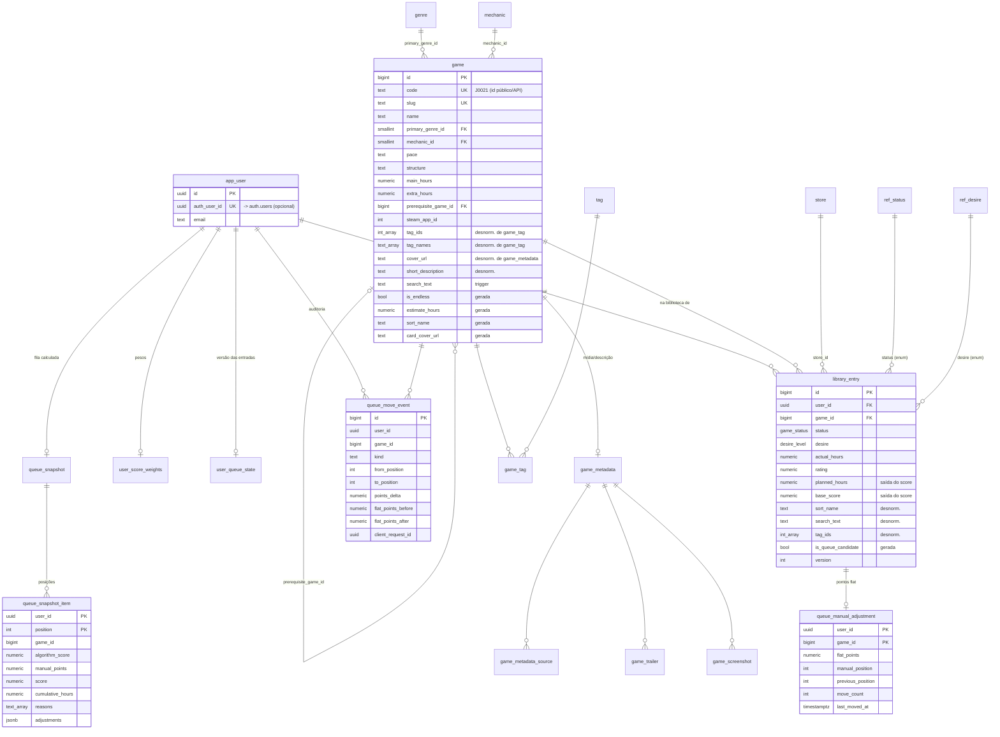

# Checkpoint: banco PostgreSQL / Supabase

Schema para PostgreSQL 15+ (Supabase). Validado em PostgreSQL 18 via PGlite, incluindo:

- reexecução das migrações (idempotência);
- seed com e sem metadados;
- triggers de desnormalização e invalidação da fila;
- `apply_queue_move` (incluindo retry idempotente);
- RLS com os papéis `authenticated` e `anon`.

| Arquivo                               | Conteúdo                                                                                                                                                                                                                                                                                                                  |
| ------------------------------------- | ------------------------------------------------------------------------------------------------------------------------------------------------------------------------------------------------------------------------------------------------------------------------------------------------------------------------- |
| `migrations/001_init.sql`             | Extensões, enums/domínios, usuários, catálogo (`game`), vocabulários, metadados de mídia, `library_entry`, pesos e reordenação manual (`queue_manual_adjustment` + `queue_move_event`). Também traz os triggers de desnormalização, as funções `apply_queue_move`/`reset_queue_adjustments` e a view `library_card`.      |
| `migrations/002_queue_snapshot.sql`   | Fila materializada (`queue_snapshot`, `queue_snapshot_item`), `user_queue_state.inputs_version` e os triggers de invalidação. Também cria a view `queue_freshness`.                                                                                                                                                       |
| `migrations/003_rls.sql`              | RLS e grants. Também cria `current_app_user_id()` e `ensure_app_user()`, a FK opcional para `auth.users` e os shims `auth.uid()`/roles para Postgres puro.                                                                                                                                                                |
| `migrations/007_scoring_settings.sql` | `user_score_weights.rules` (regras ligadas/desligadas) e `version` (sobe a cada gravação da tela de configurações).                                                                                                                                                                                                       |
| `migrations/009_game_lists.sql`       | Várias listas por usuário (`game_list`: só o nome; todas mostram todos os jogos). `user_score_weights` passa a ter PK `list_id`; `queue_manual_adjustment` PK `(list_id, game_id)`; `queue_move_event.list_id`. FKs compostas `(user_id, list_id)` → `game_list` com CASCADE. Dados antigos vão para a lista "Principal". |
| `seed/import.mjs`                     | Gera `seed/seed.sql` a partir de `api/src/seed.ts` e de `data/metadata/game-metadata.json` (se o arquivo existir). Não precisa de banco nem de dependências npm.                                                                                                                                                          |

```bash
node db/seed/import.mjs            # insere o que falta (não sobrescreve edições já no banco)
node db/seed/import.mjs --force    # sobrescreve catálogo/biblioteca com o seed
# opções: --user <uuid> --email <e-mail> --metadata <arquivo.json> --out <arquivo.sql>

psql "$DATABASE_URL" -v ON_ERROR_STOP=1 \
  -f db/migrations/001_init.sql -f db/migrations/002_queue_snapshot.sql \
  -f db/migrations/003_rls.sql  -f db/seed/seed.sql
```

No Supabase, copie `migrations/*.sql` para `supabase/migrations/` com prefixo de timestamp, mantendo a ordem 001 → 002 → 003. Use `seed/seed.sql` como `supabase/seed.sql`. Rode `import.mjs` de novo sempre que o JSON de metadados mudar: os metadados sempre sofrem upsert, mesmo sem `--force`.

---

## Diagrama ER



---

## Decisões de modelagem

### Catálogo global e biblioteca por usuário

- **`game`** representa a obra e é compartilhado entre usuários. Guarda nome, gênero, mecânica, ritmo, estrutura, estimativas de horas, fonte do tempo, pré-requisito, Steam App ID e tags.
- **`library_entry`** guarda o estado pessoal de cada usuário: status, vontade, loja, plataforma, horas jogadas, datas, nota, notas, horas Steam e o legado `imported` em jsonb. A chave `UNIQUE (user_id, game_id)` impede que o mesmo jogo entre duas vezes na biblioteca de alguém.
- **Ressalva:** a API atual (`PATCH /games/:id`) também edita campos que aqui são do catálogo, como `name`, `primaryGenre`, `pace` e horas estimadas. Com um único usuário, gravar em `game` é suficiente. Com vários usuários, essas edições devem passar por um papel de curador. A alternativa é criar overrides por usuário, que ainda não existem neste schema.

### Chaves

- **Chaves internas `bigint identity`:** joins e índices de 8 bytes, mais rápidos e menores que `text`.
- **Id público `game.code`:** é `text UNIQUE` e guarda `"J0021"` para os jogos do seed. Assim a API e o front continuam usando o mesmo `Game.id`. Jogos novos recebem `G00001`, `G00002`… por sequence. `game.slug` serve para URLs amigáveis; um trigger preenche o slug a partir do nome e acrescenta o código em caso de colisão.
- **Usuários usam `uuid`:** o formato é o mesmo de `auth.users`. A tabela se chama `app_user`, não `users`, e vincula-se ao Supabase por `auth_user_id` (FK criada só se `auth.users` existir).
  - O seed cria o dono padrão `00000000-0000-4000-8000-000000000001` sem vínculo.
  - Para reivindicá-lo depois do primeiro login: `UPDATE app_user SET auth_user_id = '<auth uid>' WHERE id = '00000000-0000-4000-8000-000000000001';`
  - Usuários novos chamam a RPC `ensure_app_user()`.

### Status e vontade

- São enums com códigos estáveis: `game_status` (`not_started`, `playing`, `abandoned`, `finished`) e `desire_level` (`very_high` … `very_low`). Ocupam 4 bytes.
- **A ordem de declaração é a ordem de negócio:** `ORDER BY desire` coloca "Muito Alta" primeiro.
- **Rótulos pt-BR e atributos de regra:** ficam nas tabelas `ref_status` (`label_pt`, `queue_eligible`) e `ref_desire` (`label_pt`, `points` = 100/75/50/25/0).
- O repositório converte entre os dois formatos:

| API          | `status`      | API         | `desire`    |
| ------------ | ------------- | ----------- | ----------- |
| Não iniciado | `not_started` | Muito Alta  | `very_high` |
| Jogando      | `playing`     | Alta        | `high`      |
| Abandonado   | `abandoned`   | Média       | `medium`    |
| Finalizado   | `finished`    | Baixa       | `low`       |
|              |               | Muito Baixa | `very_low`  |

### Vocabulários

- `genre`, `mechanic`, `tag` e `store` têm `id` pequeno e uma coluna gerada `key = norm_key(name)`, que é UNIQUE. `norm_key` é o mesmo `normal()` do `scoring.ts`: sem acento, minúsculo, com trim.
- `pace`, `structure`, `coop`, `size_label` e `time_verification` continuam `text`, porque a API aceita texto livre nesses campos.

### Colunas geradas

| Coluna                             | Regra                                                                                                         |
| ---------------------------------- | ------------------------------------------------------------------------------------------------------------- |
| `game.is_endless`                  | `norm_key(structure) = 'sem fim definido'`; vale para `finiteCampaign`                                        |
| `game.estimate_hours`              | `extra > main > previous`, a mesma ordem de `estimate()`                                                      |
| `game.sort_name`                   | `norm_key(name)`                                                                                              |
| `game.card_cover_url`              | Usa a capa dos metadados; se não houver, o header da Steam pelo App ID (substitui o `coverUrl` montado no TS) |
| `library_entry.is_queue_candidate` | `status IN (not_started, playing) AND NOT is_endless`; é a regra `pending()`                                  |

### Metadados de mídia

- **`game_metadata` é 1:1 com `game`.** Guarda o texto, `release_date` (quando a data pode ser convertida) e `release_date_text` (o valor bruto).
- `developers`, `publishers` e `source_genres` são `text[]` com índice GIN.
- `confidence` é um enum. `extra jsonb` reserva espaço para campos futuros do coletor.
- **Listas filhas normalizadas:** `game_screenshot`, `game_trailer` e `game_metadata_source`, cada uma com `position`. Ficam fora do caminho quente e só a tela de detalhes as lê.
- **Ids divergentes:** `steam_app_id` existe nos metadados e em `game`. O trigger só preenche `game.steam_app_id` quando está vazio. O seed tem App IDs repetidos (DMC 1/2/3 compartilham 631510), por isso o campo **não** é único.

---

## Performance e desnormalização

A tela de lista e a fila são o caminho quente. Cada desnormalização abaixo tem uma única fonte da verdade e é mantida por trigger, então a aplicação não precisa lembrar de sincronizar nada.

| Cópia                                                                                                                   | Fonte da verdade     | Por quê                                                                                                                                                              | Consistência                                                                                                                                      |
| ----------------------------------------------------------------------------------------------------------------------- | -------------------- | -------------------------------------------------------------------------------------------------------------------------------------------------------------------- | ------------------------------------------------------------------------------------------------------------------------------------------------- |
| `game.tag_ids` / `tag_names`                                                                                            | `game_tag`           | O card mostra as tags sem join N:N. `tag_ids` com GIN filtra por tag e `tag_names` alimenta a busca.                                                                 | Triggers `trg_game_tag_sync` e `trg_tag_rename` (renomear uma tag refaz os arrays).                                                               |
| `game.cover_url`, `header_url`, `short_description`, `release_date`/`release_year`, `developers`, `metadata_confidence` | `game_metadata`      | O card da listagem e da fila lê só `game`, sem join com metadados e mídia.                                                                                           | `trg_game_metadata_sync` (insert, update e delete).                                                                                               |
| `game.search_text`                                                                                                      | `name` + `tag_names` | Busca "nome + tags" igual ao `server.ts`, com índice trigram.                                                                                                        | Trigger `BEFORE` em `game`. `array_to_string` não é IMMUTABLE, por isso não pode ser coluna gerada.                                               |
| `library_entry.game_code`, `sort_name`, `search_text`, `primary_genre_id`, `tag_ids`, `is_endless`                      | `game`               | **Filtro + ordenação + LIMIT numa tabela só**, com índices compostos que começam por `user_id`. O join com `game` acontece só para as ~24 linhas da página, por PK.  | `trg_library_entry_fill` (BEFORE INSERT/UPDATE copia de `game`) e `trg_game_propagate` (AFTER UPDATE em `game`, só quando um desses campos muda). |
| `library_entry.planned_hours`, `affinity`, `base_score`                                                                 | `scoreGames()` no TS | Permite `sort=score` paginado pelo índice, sem rodar o algoritmo para listar. A afinidade depende de todas as notas do usuário, então não dá para ser coluna gerada. | Responsabilidade da aplicação: grava ao recalcular a fila, na mesma transação. Gravar essas colunas **não** invalida a fila.                      |
| `queue_snapshot*`                                                                                                       | Algoritmo + entradas | A fila custa O(n²) a cada leitura no TS. O snapshot transforma a leitura num range scan.                                                                             | Triggers da migração 002 incrementam `inputs_version` (ver abaixo).                                                                               |

**O que não foi desnormalizado, e por quê:**

- **Capa e descrição não vão para `library_entry`.** Cada atualização de metadados geraria escritas em N usuários, e o join `library_entry → game` por PK custa microssegundos para uma página.
- **O snapshot da fila não guarda o card do jogo.** Notas, capa e nome mudariam sem invalidar a fila. O snapshot guarda só o que é caro de calcular (posição, score, horas acumuladas, motivos e ajustes) e junta o card por PK na leitura.

**Índices de `library_entry`:**

- `(user_id, sort_name, id)`, `(user_id, base_score DESC NULLS LAST, id)` e `(user_id, desire, sort_name, id)`: um por ordenação da tela, que permite keyset pagination.
- `(user_id, status, sort_name)`: filtro de status e contagens do `/catalog` com index-only scan.
- `(user_id, primary_genre_id)`, `(user_id, store_id)` e o GIN `(user_id, tag_ids)` via `btree_gin`.
- GIN trigram `(user_id, search_text gin_trgm_ops)`: indexa `LIKE '%texto%'`.
- Índice parcial `(user_id, game_id) WHERE is_queue_candidate`: carrega só os candidatos da fila.
- Índice parcial `(user_id, finished_at DESC) WHERE status='finished'`: histórico dos três últimos jogos para o contexto.

Em `game` há trigram em `search_text` para a busca global ("adicionar jogo") e GIN em `tag_ids` e `developers`.

**Ordenação por nome:** `sort_name` é `norm_key(name)` na collation padrão do banco, o que aproxima o `localeCompare('pt-BR')`. Se precisar de fidelidade total, use `ORDER BY name COLLATE "pt-BR-x-icu"`. Isso exige ICU, que o Supabase tem, e um índice com essa collation.

---

## Fila: snapshot e invalidação

> **Fora de uso.** A API não lê nem grava mais o snapshot: ela lê as entradas numa única query e calcula a fila em memória (~50 ms). O snapshot poupava só esse cálculo e custava uma regravação a cada mudança. As tabelas e os triggers abaixo continuam no banco até uma migração removê-los.

O algoritmo é guloso e contextual e vive em TypeScript, por isso não pode ser uma `MATERIALIZED VIEW`. A fila funciona com duas versões:

- `user_queue_state.inputs_version` é incrementado por triggers sempre que uma **entrada** do algoritmo muda:
  - `library_entry`: insert, delete, ou mudança em `status`, `desire`, `actual_hours`, `finished_at`, `rating`, gênero, tags, `is_endless` e `game_id`. São triggers por statement com transition tables, então uma importação em massa gera 1 UPDATE por usuário.
  - `game`: `pace`, `structure`, `mechanic_id`, horas e pré-requisito, afetando todos os usuários que têm o jogo.
  - `user_score_weights`.
  - `queue_manual_adjustment`.
  - Mudar `notes`, `platform` ou as colunas de saída do score **não** invalida a fila.
- `queue_snapshot.inputs_version` registra de qual versão o snapshot foi calculado. Ele é **fresco** quando as duas versões são iguais.

**Protocolo de leitura** (`GET /recommendations`):

```sql
-- 1) Frescor + cabeçalho (PK lookups)
SELECT qs.*, (qs.inputs_version = st.inputs_version) AS is_fresh
FROM user_queue_state st LEFT JOIN queue_snapshot qs USING (user_id)
WHERE st.user_id = $1;
```

**Se o snapshot estiver fresco**, leia as posições. A query faz um range scan na PK `(user_id, position)` e junta os cards por PK:

```sql
SELECT i.position, i.score, i.algorithm_score, i.manual_points, i.cumulative_hours,
       i.planned_hours, i.base_score, i.affinity, i.reasons, i.adjustments,
       c.*                                        -- card: nome, capa, tags, status...
FROM queue_snapshot_item i
JOIN library_card c ON c.entry_id = i.library_entry_id
WHERE i.user_id = $1
ORDER BY i.position;
```

**Se estiver velho ou não existir**, recalcule numa transação:

1. `BEGIN; SELECT pg_advisory_xact_lock(hashtextextended($1::text, 0));`. O lock evita que duas requisições recalculem ao mesmo tempo.
2. Leia `v := inputs_version` **antes** de ler as entradas. Se alguém escrever no meio, a versão sobe e o próximo read recalcula, o que é conservador e correto.
3. Carregue as entradas: `library_entry` + `game` + pesos + `queue_manual_adjustment`. Rode `recommendGames`, somando `flat_points` ao score contextual de cada candidato **antes** da escolha gulosa. Inclua `{label:"Ajuste manual", points}` em `adjustments`.
4. Grave o resultado:
   - `DELETE FROM queue_snapshot_item WHERE user_id=$1;`
   - INSERT em lote dos itens;
   - `INSERT ... ON CONFLICT (user_id) DO UPDATE` em `queue_snapshot`, com `inputs_version = v`;
   - `UPDATE library_entry SET planned_hours, affinity, base_score, scored_at` (não invalida);
   - `COMMIT`.

`algorithm_version` permite invalidar todos os snapshots quando a regra mudar no código: compare com uma constante da aplicação.

---

## Reordenação manual (drag-and-drop)

> Desde `009_game_lists.sql` o estado e o histórico são **por lista**: PK `(list_id, game_id)`, `queue_move_event.list_id`, e `apply_queue_move`/`reset_queue_adjustments` recebem `p_list_id`. O texto abaixo descreve o desenho original por usuário.

**`queue_manual_adjustment`** (estado acumulado; PK `(user_id, game_id)`; FK `(user_id, game_id)` → `library_entry`, com CASCADE):

| Coluna                     | Tipo                    | Significado                                              |
| -------------------------- | ----------------------- | -------------------------------------------------------- |
| `user_id`                  | uuid                    | Dono                                                     |
| `game_id`                  | bigint                  | `game.id` interno. Na API, use `game.code`.              |
| `flat_points`              | numeric(8,2), default 0 | Soma de todos os deltas, somada ao score do algoritmo    |
| `manual_position`          | int null                | Posição onde o usuário soltou o jogo no último movimento |
| `previous_position`        | int null                | Posição antes do último movimento                        |
| `move_count`               | int                     | Quantidade de movimentos                                 |
| `last_moved_at`            | timestamptz             | Momento do último movimento                              |
| `created_at`, `updated_at` | timestamptz             | Timestamps                                               |

**`queue_move_event`** (auditoria imutável; o cliente só pode ler e inserir):

| Coluna                                    | Significado                                                                                           |
| ----------------------------------------- | ----------------------------------------------------------------------------------------------------- |
| `id` (identity)                           | Identificador do evento                                                                               |
| `user_id`, `game_id`                      | Quem moveu e qual jogo. Sem FK para `library_entry`, então o histórico sobrevive à remoção do jogo.   |
| `kind`                                    | `move` \| `reset` \| `set`                                                                            |
| `from_position`, `to_position`            | Posição de origem e de destino                                                                        |
| `points_delta`                            | Delta de pontos aplicado                                                                              |
| `flat_points_before`, `flat_points_after` | Saldo antes e depois. Um CHECK garante `after = before + delta` para `move`.                          |
| `score_before`                            | Score exibido no momento do movimento (opcional)                                                      |
| `anchor_game_id`                          | Jogo que ocupava `to_position` (opcional)                                                             |
| `queue_version`                           | `inputs_version` da fila que o usuário via. Serve para detectar movimento feito sobre uma fila velha. |
| `source`                                  | `drag` \| `keyboard` \| `button` \| `api` \| `system`                                                 |
| `client_request_id` (uuid)                | Idempotência: único por usuário                                                                       |
| `created_at`                              | Momento do evento                                                                                     |

**Como aplicar um movimento.** A função é atômica, trava a linha com `FOR UPDATE` e é idempotente por `client_request_id`:

```sql
SELECT * FROM apply_queue_move(
  p_user_id        => $1,
  p_game_id        => (SELECT id FROM game WHERE code = $2),
  p_from_position  => 10,
  p_to_position    => 3,
  p_points_delta   => 12.5,
  p_source         => 'drag',
  p_request_id     => $3,      -- uuid gerado no front; um retry não aplica duas vezes
  p_queue_version  => $4,      -- inputs_version que o front recebeu com a fila
  p_score_before   => 61.2,
  p_anchor_game_id => (SELECT id FROM game WHERE code = $5));
-- retorna a linha atualizada de queue_manual_adjustment; o trigger invalida a fila
```

A mesma operação em SQL simples, se preferir não usar a função:

```sql
BEGIN;
INSERT INTO queue_manual_adjustment (user_id, game_id) VALUES ($1, $2) ON CONFLICT DO NOTHING;
SELECT flat_points FROM queue_manual_adjustment WHERE user_id=$1 AND game_id=$2 FOR UPDATE;
INSERT INTO queue_move_event (user_id, game_id, kind, from_position, to_position, points_delta,
                              flat_points_before, flat_points_after, source, client_request_id, queue_version)
VALUES ($1, $2, 'move', $from, $to, $delta, $before, $before + $delta, 'drag', $req, $ver);
UPDATE queue_manual_adjustment
   SET flat_points = flat_points + $delta, previous_position = $from, manual_position = $to,
       move_count = move_count + 1, last_moved_at = now()
 WHERE user_id=$1 AND game_id=$2;
COMMIT;
```

Para zerar os ajustes, `SELECT reset_queue_adjustments($user)` zera todos, e `SELECT reset_queue_adjustments($user, $game_id)` zera um jogo. A função registra eventos `reset`.

**Como calcular o delta.** Isto fica na aplicação. Seja `s(x)` o `score` final do snapshot.

- **Mover para frente**, para a posição `j`: `delta = s(item em j) − s(jogo) + ε`, com ε ≈ 0,5.
- **Mover para trás**: `delta = s(item em j) − s(jogo) − ε`.

Como o algoritmo é contextual e recalcula a cada posição, o jogo pode parar a uma ou duas posições do alvo. Se precisar de precisão, recalcule, compare com `manual_position` e aplique um segundo evento corretivo com `source='system'`. O campo `manual_position` também permite, no futuro, tratar a posição como "fixada".

---

## Queries principais

**1. Biblioteca paginada com filtros.** Query de `GET /games`:

```sql
SELECT c.*
FROM library_card c
WHERE c.user_id = $1
  AND ($status::game_status IS NULL OR c.status = $status)              -- library_entry_user_status_idx
  AND ($genre  IS NULL OR c.primary_genre_id = (SELECT id FROM genre WHERE key = norm_key($genre)))
  AND ($store  IS NULL OR c.store_id = (SELECT id FROM store WHERE key = norm_key($store)))
  AND ($tag    IS NULL OR c.tag_ids @> ARRAY[(SELECT id FROM tag WHERE key = norm_key($tag))])  -- GIN (user_id, tag_ids)
  AND ($q = '' OR c.search_text LIKE '%' || norm_key($q) || '%')         -- GIN trigram (user_id, search_text)
ORDER BY c.sort_name, c.entry_id                                         -- library_entry_user_name_idx
LIMIT $pageSize OFFSET ($page - 1) * $pageSize;
-- sort=score : ORDER BY c.base_score DESC NULLS LAST, c.entry_id  (library_entry_user_score_idx)
-- sort=desire: ORDER BY c.desire, c.sort_name, c.entry_id          (library_entry_user_desire_idx)
-- keyset:      AND (c.sort_name, c.entry_id) > ($lastSortName, $lastId) em vez de OFFSET
-- total:       mesma query com count(*) direto em library_entry (sem joins)
```

Para gerar SQL estático, prefira montar o WHERE dinamicamente em vez do padrão `$x IS NULL OR ...`. Assim o planner escolhe o índice certo em cada combinação de filtros.

**2. Opções e contagens.** Query de `GET /catalog`:

```sql
SELECT status, count(*) FROM library_entry WHERE user_id = $1 GROUP BY status;   -- index-only scan
SELECT DISTINCT ge.name FROM library_entry e JOIN genre ge ON ge.id = e.primary_genre_id WHERE e.user_id = $1;
SELECT DISTINCT t.name FROM library_entry e CROSS JOIN unnest(e.tag_ids) u(id) JOIN tag t ON t.id = u.id WHERE e.user_id = $1;
```

**3. Detalhes com mídia.** Uma única ida ao banco:

```sql
SELECT c.*, m.description, m.description_lang, m.hero_url, m.publishers, m.release_date_text, m.confidence,
  (SELECT coalesce(json_agg(s ORDER BY s.position), '[]') FROM game_screenshot s WHERE s.game_id = c.game_id) AS screenshots,
  (SELECT coalesce(json_agg(t ORDER BY t.position), '[]') FROM game_trailer t WHERE t.game_id = c.game_id) AS trailers,
  (SELECT coalesce(json_agg(x ORDER BY x.position), '[]') FROM game_metadata_source x WHERE x.game_id = c.game_id) AS sources
FROM library_card c LEFT JOIN game_metadata m ON m.game_id = c.game_id
WHERE c.user_id = $1 AND c.code = $2;
```

**4. Ler a fila e aplicar movimento:** ver as seções acima.

---

## Supabase e RLS

- **Extensões:** ficam em `extensions` (`pg_trgm`, `btree_gin`, `unaccent`). O wrapper IMMUTABLE `immutable_unaccent` descobre o schema da extensão durante a migração.
- **Catálogo:** `game`, os vocabulários, os metadados e a mídia têm `SELECT` liberado para `anon` e `authenticated`. Só o backend escreve, com `service_role` ou conexão direta, que ignoram a RLS.
- **Dados pessoais:** `library_entry`, `user_score_weights` e `queue_manual_adjustment` seguem a regra `user_id = (SELECT current_app_user_id())`. O `SELECT` em volta faz o valor ser avaliado uma vez por query, como InitPlan.
- **Auditoria:** em `queue_move_event` o cliente só pode ler e inserir.
- **Fila e estado:** `queue_snapshot*` e `user_queue_state` são só leitura para o cliente.
- **Views:** `library_card` e `queue_freshness` usam `security_invoker`, então respeitam a RLS de quem consulta.
- **Triggers:** os que escrevem em outras tabelas são `SECURITY DEFINER` com `search_path` fixo. Isso permite, por exemplo, que um usuário invalide a própria fila sem ter permissão de escrita em `user_queue_state`. Funções internas (`bump_queue_version`, `refresh_game_tags`) têm `EXECUTE` revogado de `anon` e `authenticated`.
- **API Node:** a API atual roda no servidor. Se ela usar `service_role` ou `DATABASE_URL` direto, precisa filtrar por `user_id` explicitamente, porque a RLS não se aplica. Se o front passar a consultar o Supabase direto, a RLS cobre.
- **Postgres puro:** a migração 003 cria os shims `auth.uid()`, que lê `request.jwt.claim.sub`, e os roles `anon`/`authenticated` (NOLOGIN), para que as policies compilem.
